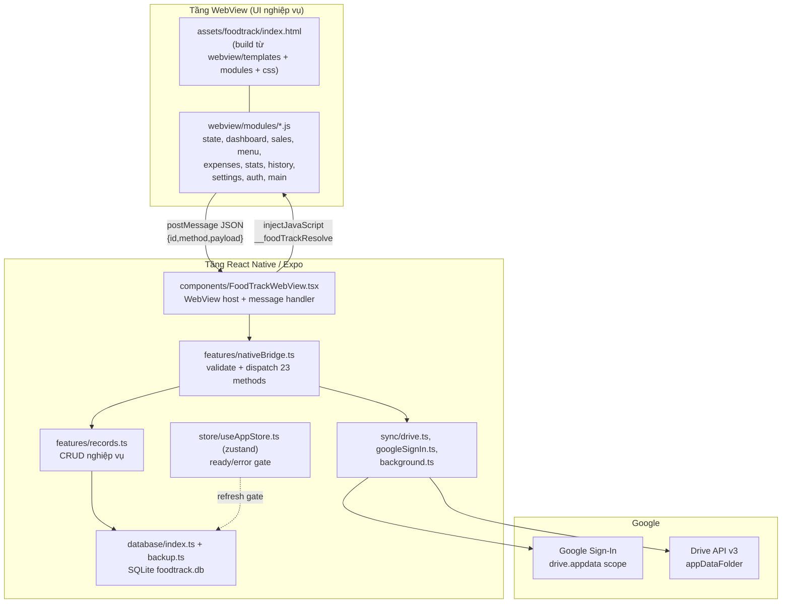
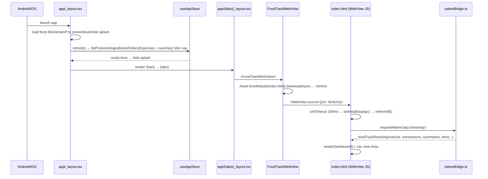

# 01 — Tổng quan và kiến trúc hệ thống

## 1.1. Sản phẩm là gì

**FoodTrack** là ứng dụng mobile (Android ưu tiên, có cấu hình iOS) giúp chủ quán ăn vặt:

- Ghi nhận **đơn bán hàng** (POS tối giản: chọn món → số lượng → phương thức thanh toán).
- Ghi nhận **chi phí** (nhập hàng / chi khác).
- Xem **lợi nhuận** theo ngày/tuần/tháng/năm, lịch sử giao dịch.
- Quản lý **menu món ăn** (tên, giá, mô tả, ảnh, trạng thái bán).
- **Sao lưu & đồng bộ** toàn bộ dữ liệu lên Google Drive (appDataFolder), hỗ trợ nhiều thiết bị và khôi phục.

Toàn bộ dữ liệu lưu **offline** trong SQLite trên thiết bị (`foodtrack.db`). Không có server riêng; Google Drive đóng vai trò "cloud storage" cho backup/sync.

## 1.2. Kiến trúc tổng thể

Ứng dụng gồm **3 tầng chính**:

### Điểm quan trọng

- **Chỉ có 1 WebView duy nhất** render toàn bộ 6 tab (Tổng quan, Bán hàng, Menu, Thống kê, Lịch sử, Cài đặt). Chuyển tab là JS thuần trong WebView (`switchTab()`), không qua React Navigation.
- File `app/(tabs)/_layout.tsx` trả về `<FoodTrackWebView />` cho mọi route trong `(tabs)` — các file `app/(tabs)/index.tsx`, `sales.tsx`, `menu.tsx`, `history.tsx`, `stats.tsx` là **code native legacy không được hiển thị** (xem [09-han-che.md](09-han-che.md)).
- Root layout `app/_layout.tsx` nạp font Be Vietnam Pro, giữ splash screen tới khi `useAppStore.refresh()` xong, rồi mount `Stack` với `(tabs)` + `settings`.

## 1.3. Công nghệ

| Tầng | Công nghệ | Ghi chú |
|------|-----------|---------|
| Framework | Expo SDK ~58.0.26, React Native 0.88.1, React 19.3.0 | `jsEngine: hermes` |
| Router | expo-router ~58.0.32 (typedRoutes) | `app/` là route root (không phải `src/app`) |
| WebView | react-native-webview 14.0.1 | `androidLayerType="hardware"`, `cacheEnabled={false}` |
| DB | expo-sqlite ~58.0.18 | WAL mode, busy_timeout 5000, foreign_keys ON |
| State native | zustand ^5.1.0 | chỉ `useAppStore` cho gate khởi động + settings |
| Auth/Drive | @react-native-google-signin/google-signin ^17, expo-secure-store | scope `drive.appdata`, token trong SecureStore |
| Background | expo-background-task + expo-task-manager | task `FOODTRACK_DAILY_DRIVE_SYNC`, tối thiểu 24h |
| Ảnh | expo-image-picker + expo-image-manipulator (+ expo-media-library legacy) | resize 800px JPEG base64 |
| UI web | Tailwind CSS 3.4.17 (prebuilt `webview/generated.css`), font Be Vietnam Pro + Material Symbols nhúng base64 | hoàn toàn offline |
| Build | `scripts/build-webview.js` (Node, CommonJS) | concat templates + inject CSS/JS |

Chi tiết dependency: [package.json](../package.json). Cấu hình native: [app.json](../app.json), `eas.json`.

## 1.4. Hai "thế giới" song song cần phân biệt

| | WebView UI (đang dùng) | Native screens (legacy) |
|---|---|---|
| File | `webview/templates/*`, `webview/modules/*`, `assets/foodtrack/index.html` | `app/(tabs)/*.tsx`, `components/ui.tsx`, `ExpenseSheet.tsx`, `LocalPhotoPicker.tsx`, `HeaderActions.tsx` |
| Dữ liệu | qua Native Bridge → `features/records.ts` | gọi trực tiếp `features/records.ts` |
| Trạng thái | **UI chính** | Route tồn tại nhưng không được render (xem mục 9) |

Khi bảo trì, **mọi thay đổi UX phải sửa trong `webview/` rồi chạy `node scripts/build-webview.js`** — không sửa `assets/foodtrack/index.html` trực tiếp (file generated).

## 1.5. Luồng khởi động

Chi tiết bridge request/response: [04-webview-bridge.md](04-webview-bridge.md).
